# Electro

## Convertidores lógicos

[VIDEO](<https://youtu.be/OC-RfQQUrC0>) de referencia

Cuando un circuito requiere inter conectar microcontroladores y/o sensores que trabajan a diferentes voltajes, es necesario un componente intermedio que adapte los voltajes para evitar sobre voltajes o errores de lectura de niveles lógicos.

Se puede conectar 3.3v a 5V (a riesgo de no llegar a saturar el uno lógico), pero de 5v a 3.3v va a quemar las entradas, aunque existen microcontroladores `FT`(Five Volt Tolerant), por eso para evitar problemas se utilizan convertidores lógicos (Logic Level Converters),

Los convertidores lógicos se pueden realizar directamente en el PCB, uno de los diseños más comunes es a partir del transistor MosFet BSS138 en su versión simple, o el encapsulado `SOT-363` BSS138DW que contiene dos unidades

<a href="https://github.com/ec4lab/LandPage">
  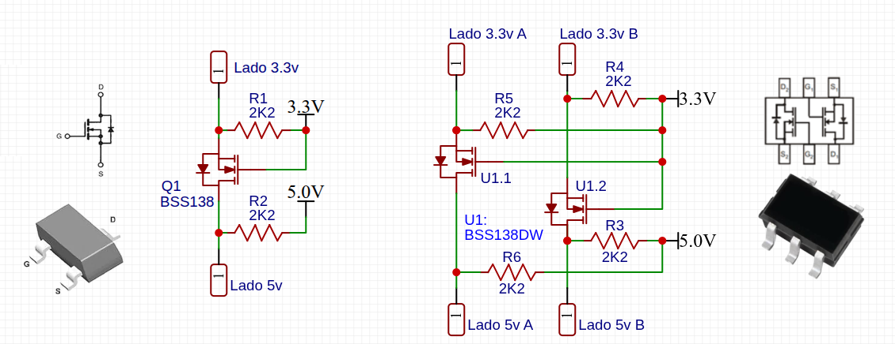
</a>

Recomendaciones al utilizar convertidores lógicos:

* Asegurar que los voltajes estén del lado correcto
* no exceder los 50mA por canal
* En comunicaciones I2C usar resistencias Pull-Up
* Mantener el cableado (o pistas de PCB) lo más cortas posibles

Existen en el mercado módulos, que muchas veces por su bajo costo y practicidad conviene utilizar

### Convertidor lógico TXS0108E

Convertidor lógico bidireccional de 8 canales

<a href="https://github.com/ec4lab/LandPage">
  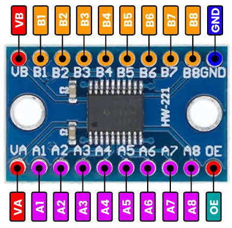
</a>

Detalles técnicos

* Voltajes lado alto: 1.65V hasta 5.5V
* Voltajes lado bajo: 1.4V hasta 3.6V
* Corriente máxima por canal: 50mA
* Cantidad de canales: 8 bidireccionales
* Velocidad de datos: Hasta 110 Mbps (en modo push-pull) y 1.2 Mbps (en drenaje abierto)
* Dimensiones:
* Rango de temperaturas de operación: -40°C to 85°C

|Pin|Descripción|
|---|---|
|Bx|Entradas/Salidas de alto voltaje|
|Ax|Entradas/Salidas de bajo voltaje|
|GND|Tierra  (unir ambos lados)|
|VB|Voltaje de referencia del lado alto|
|VA|Voltaje de referencia del lado bajo|
|OE|Habilitación,nivel alto para activar salidas, GND para impedancia|

### SparkFun Logic Level Converter BOB-12009

Convertidor lógico bidireccional de 4 canales, también existen [genéricos](<https://www.mercadolibre.com.ar/x3-modulo-adaptador-conversor-nivel-logico-5v-33v-i2c/p/MLA2098751110#polycard_client=search-desktop&be_origin=backend&overlay_label=not_apply&search_layout=grid&position=1&type=product&tracking_id=71e7d079-14fc-467b-844f-121b9797ada0&wid=MLA1670702320&sid=search>)

<a href="https://github.com/ec4lab/LandPage">
  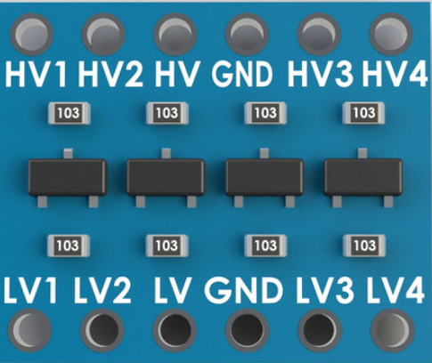
</a>

Detalles técnicos

* Voltajes lado alto: 3.3V hasta 5V
* Voltajes lado bajo: 1.8V hasta 3.3V
* Maximum Current per Channel: 50mA
* Number of Channels: 4 bidirectional channels
* Dimensions: 19.3mm x 15.2mm
* Rango de temperaturas de operación: -40°C a 85°C

Configuración de pines:

|Pin|Descripción|
|---|---|
|HVx|Entradas/Salidas de alto voltaje|
|LVx|Entradas/Salidas de bajo voltaje|
|GND|Tierra  (unir ambos lados)|
|HV|Voltaje de referencia del lado alto|
|LV|Voltaje de referencia del lado bajo|

Ejemplo de comunicación entre Arduino y ESP32 [Aquí](<https://docs.cirkitdesigner.com/component/71c0c9b9-1608-4035-99cc-13280d3cdee3>)

## Motores Paso a Paso

### Motores Bipolares

Son motores de 4 cables, no hay punto medio, son 2 bobinas conectadas de a pares.

<a href="https://github.com/ec4lab/LandPage" target="_blank" rel="noopener noreferrer">
    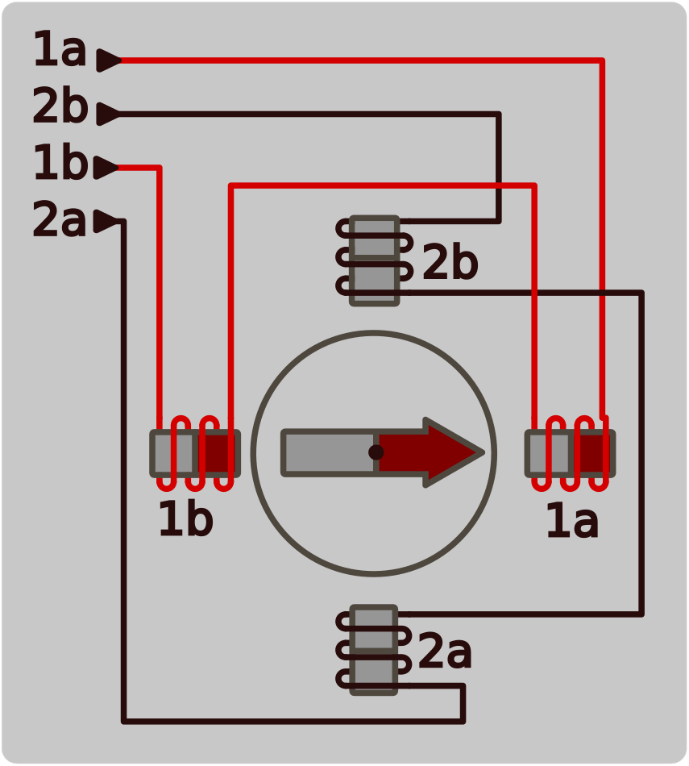
</a>
<figcaption align="center" style="margin-top: 0px; font-size: 14px; color: #555;">
Esquema de un motor stepper Bipolar de 4 hilos
</figcaption>

#### Motor [EM-286 STH-039H112-06](<https://thborges.github.io/blog/3d/2020/05/19/epson-stepper-em-286-sth-39h112-06-reverse-engineered-specs.html>)

Es un motor paso a paso bipolar de 4 cables.

    <!-- Primera Imagen -->
    <a href="https://github.com/ec4lab/LandPage" target="_blank" rel="noopener noreferrer">
        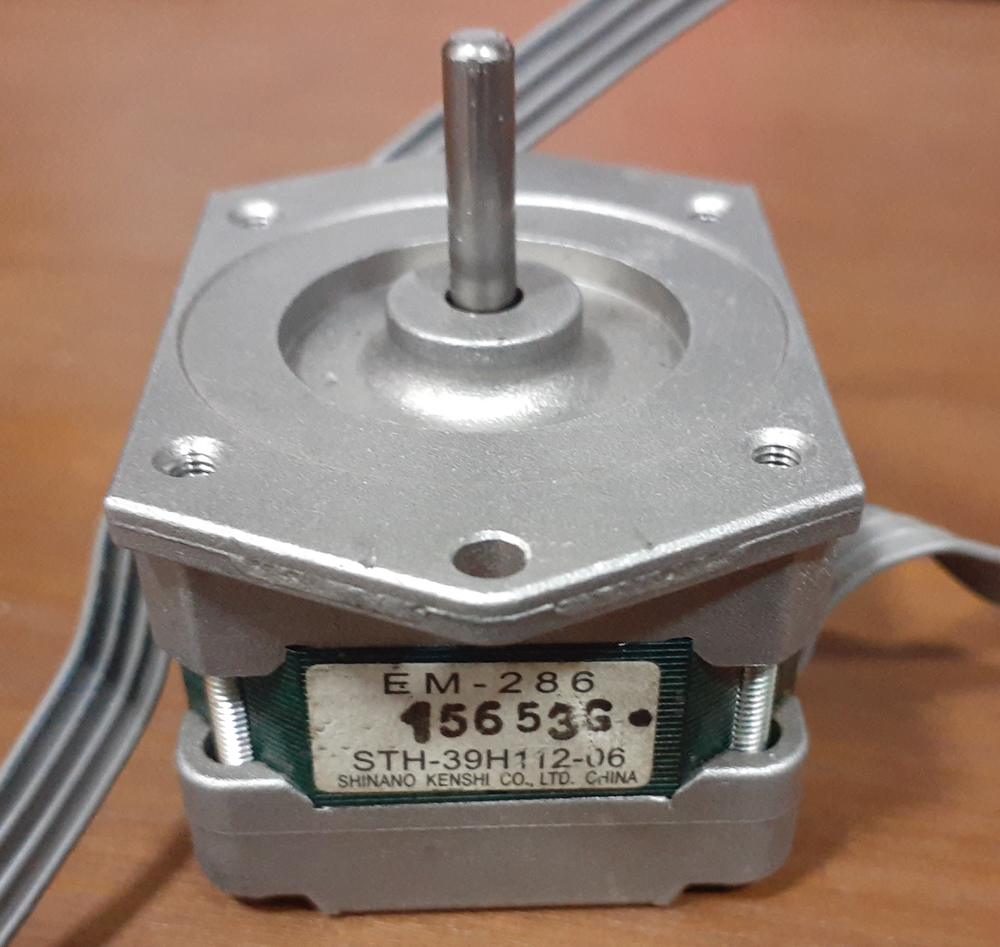
    </a>
    <!-- Segunda Imagen -->
    <a href="https://github.com/ec4lab/LandPage" target="_blank" rel="noopener noreferrer">
        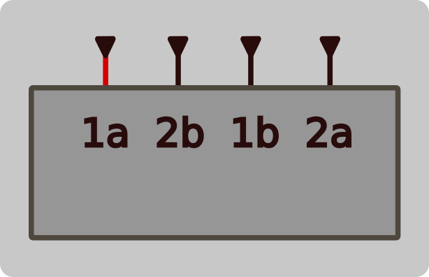
    </a>
    <figcaption align="center" style="margin-top: 10px; font-size: 14px; color: #555;">
        El motor EM-286 STH-039H112-06 y su esquema de bobinado
    </figcaption>

### Controladores

Sirven para simplificar la electrónica para el control de los steppers.  
Disponen de protecciones contra sobre intensidad, cortocircuito, sobre tensión y sobre temperatura.  
En general, son dispositivos robustos y fiables siempre que se realize la conexión correctamente, y se  incorpore disipación de calor si es necesario.
Simplifican mucho el uso ya que solo requieren dos señales digitales de control para hacer funcionar el motor.  
Más info [aquí](<https://www.luisllamas.es/motores-paso-paso-arduino-driver-a4988-drv8825/>)

Los más comunes son:

* [A4988](<https://lastminuteengineers.com/A4988-stepper-motor-driver-arduino-tutorial/>) - [Datasheet](<https://lastminuteengineers.com/drv8825-stepper-motor-driver-arduino-tutorial/>)
* [DRV8825](<https://lastminuteengineers.com/drv8825-stepper-motor-driver-arduino-tutorial/>) - [Datasheet](<https://www.ti.com/lit/ds/symlink/drv8825.pdf>)

|Modelo|A4988|DRV8825|
|---|---|---|
|Color|Verde o Rojo|Morado|
|Intensidad máxima|2A|2.5A|
|Tensión máxima|35V|45A|
|Microsteps|16|32|
|Rs típico|0.05, 0.1 o 0.2|0.1|
|Fórmulas|I_max = Vref / ( 8 . Rs)|I_max = Vref / ( 5 . Rs)|
||Vref = I_max . 8 . Rs|Vref = I_max . 5 . R|
|Imagen|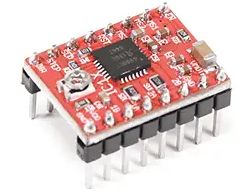|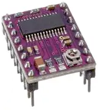|

### Conexión básica DRV8825

[Ref](<https://www.luisllamas.es/motores-paso-paso-arduino-driver-a4988-drv8825/>)  
info detallada sobre el [pinout](<https://lastminuteengineers.com/drv8825-stepper-motor-driver-arduino-tutorial/>)

<a href="https://github.com/ec4lab/LandPage" target="_blank" rel="noopener noreferrer">
    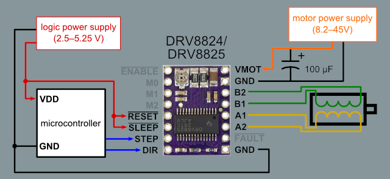
</a>
<figcaption align="center" style="margin-top: 0px; font-size: 14px; color: #555;">
Conexión típica DRV8824/25
</figcaption>

### Conexión básica A4988

[Ref](<https://www.luisllamas.es/motores-paso-paso-arduino-driver-a4988-drv8825/>)  
info detallada sobre el [pinout](<https://lastminuteengineers.com/a4988-stepper-motor-driver-arduino-tutorial/>)

<a href="https://github.com/ec4lab/LandPage" target="_blank" rel="noopener noreferrer">
    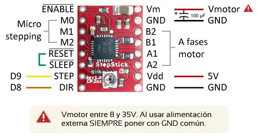
</a>
<figcaption align="center" style="margin-top: 0px; font-size: 14px; color: #555;">
Conexión típica DRV8824/25
</figcaption>

#### Pines

* Enable: Stop de emergencia o apagado del sistema.
  * Al aire – Activado. (Pull Down)
  * LOW – Activado
  * HIGH - Desactivado

* Sleep: Activado pone el driver en modo sleep, reduce el consumo al mínimo.
  * HIGH - Desactivado
  * LOW – Activado

* Reset: Activado se ignoran las señales de entrada.
  * HIGH - Desactivado
  * LOW – Activado
  * It also resets the driver by setting the internal translator to a predefined “home” state. Home state is basically the initial position from which the motor starts, and it varies based on microstep resolution. (NO CHEQUEADO)

### Limitación de corriente

Antes de hacer funcionar el motor, debe limitar la corriente máxima que fluye a través de las bobinas para que no exceda la corriente nominal del motor.
El controlador DRV8825 incluye un pequeño potenciómetro de ajuste para establecer el límite de corriente.

#### Limitación de corriente a través del trimpot

Ver la hoja de datos de su motor paso a paso.  
Tome nota de la corriente nominal.  
Desconecte los tres pines de selección de microstepping para poner el controlador en modo de paso completo.  
Mantenga el motor en una posición fija sin señales en la entrada STEP.  
Mida el voltaje (Vref) en el potenciómetro de metal mientras lo ajusta.  
Ajuste el voltaje Vref según la fórmula de la controladora

##### La resistencia Rs

Dependiendo del fabricante el valor de Rs puede variar, se deben mirar directamente en la placa:  
En el caso de la placa A4988, se identifican como S1 y S2 o como R4 y R5

<a href="https://github.com/ec4lab/LandPage" target="_blank" rel="noopener noreferrer">
    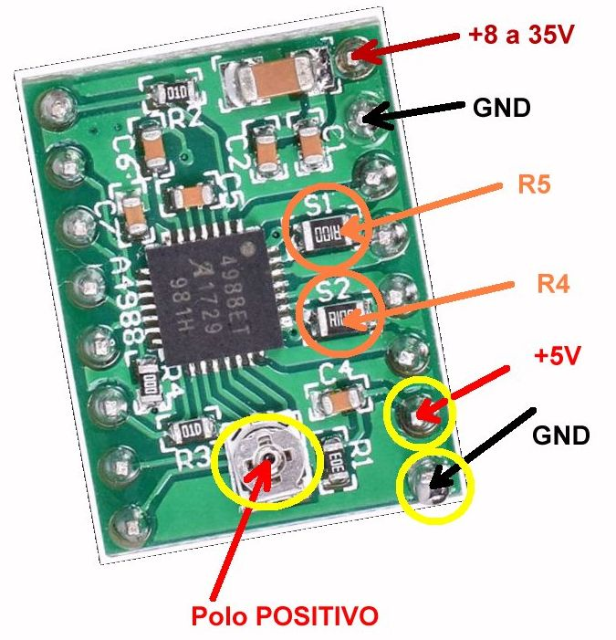
</a>
<figcaption align="center" style="margin-top: 0px; font-size: 14px; color: #555;">
Puntos de interés en la controladora A4988
</figcaption>

Las resistencias son de montaje superficial así que los valores están codificados:

|Código|Valor|
|---|---|
|R100|0.1 Ω|
|R050|0.05 Ω|
|R200|0.2 Ω|

#### Microstepping

El microstepping es una técnica que permite obtener pasos inferiores al paso nominal del motor paso a paso que vamos a controlar.  
El microstepping hace variar la corriente aplicada a cada bobina emulando un valor analógico. Si pudiéramos a ambas bobinas dar señal eléctrica senoidal perfecta desfasadas 90º conseguiríamos un campo magnético rotatorio perfecto en el interior del motor.
Por supuesto el controlador digital no genera valores analógicos perfectos, si no valores discretizados (“a saltos”), por lo que la señal eléctrica que aplica es igualmente una función senoidal discretizada.  
El resultado es un campo magnético rotativo con un paso inferior al paso nominal, que depende del número de niveles de discretos que podemos emplear en las señales de excitación de la bobina.  
Cuando funcionamos sin microstepping (Modo full step), los controladores aplican una secuencia de 2-fases, por lo que aplican de forma permanente el 71% de la corriente del limitador a cada bobina. Únicamente varían el sentido en el que la corriente circula por la bobina.  
Sin embargo, si aplicamos microstepping en cualquier de sus modos de funcionamiento, el controlador llega a aplicar el 100% de la corriente a una de las bobinas en un determinado paso. La cantidad de corriente concreta aplicada a cada bobina varía con cada paso.
Por ejemplo, con resolución 1/4 de paso, en el primer paso de la secuencia tendremos una bobina al 100% y la bobina B al 0%, en el segundo paso la bobina A al 92% y la bobina B al 38%, en el tercer paso la bobina A al 71%, y así sucesivamente.  
La resolución con la que queremos que funcione el controlador se controla aplicando tensión a los Pines M0, M1 y M2. Estos pines están puestos a tierra mediante resistencias de Pull-Up, por lo que si no conectamos nada estarán a Low, y sólo deberemos forzar los pines en High.

|Resolución||Pines|||
|---|---|---|---|---|
|A4988|DRV8825|M0|M1|M2|
|Full step|Full step|Low|Low|Low|
|1/2 step|1/2 step|High|Low|Low|
|1/4 step|1/4 step|Low|High|Low|
|1/8 step|1/8 step|High|High|Low|
|-|1/16 step|Low|Low|High|
|-|1/32 step|High|Low|High|
|-|1/32 step|Low|High|High|
|1/16 step|1/32 step|High|High|High|

## Control PWM, con ajuste automático  en motores de continua

¿Necesitas un motor de CC pequeño que funcione a baja velocidad sin detenerse cuando aumenta la carga? [Este proyecto](<https://www.elektormagazine.com/news/circuit-pwm-motor-control>)
 de control de motor mediante PWM utiliza un amplificador operacional LM358, un MOSFET y un sistema de retroalimentación basado en la detección de corriente para aumentar automáticamente el ciclo de trabajo (duty cycle) de la señal PWM cuando el motor requiere más potencia, todo ello sin necesidad de un microcontrolador.

<a href="https://github.com/ec4lab/LandPage" target="_blank" rel="noopener noreferrer">
    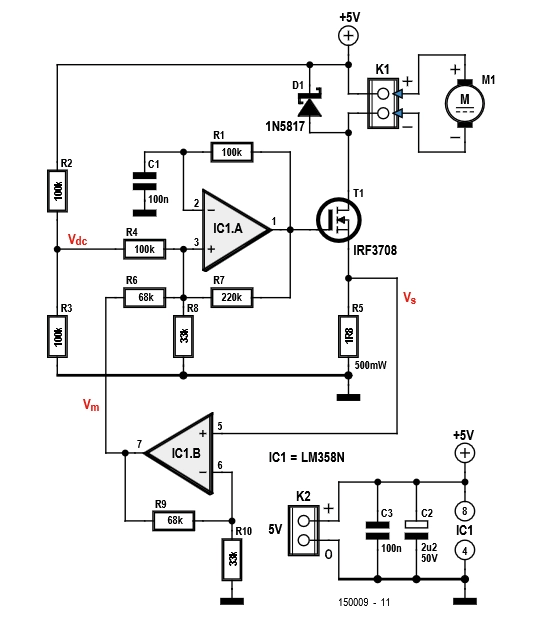
</a>
<figcaption align="center" style="margin-top: 0px; font-size: 14px; color: #555;">
Control PWM de motor con ajuste de corriente automático
</figcaption>

## Licencia de este repositorio

Este proyecto está licenciado bajo la Licencia MIT.
Está permitido el uso, copia, modificaciones y distribución del software libremente, siempre que se incluya el aviso de derechos de autor original.  

Para más información, consultar el archivo [LICENSE](LICENSE)

## Contacto

**EC4lab**  
[mail](<mailto:ec4lab@gmail.com>)  
[GitHub](<https://github.com/ec4lab/LandPage>)
